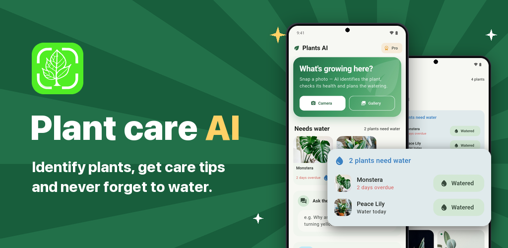
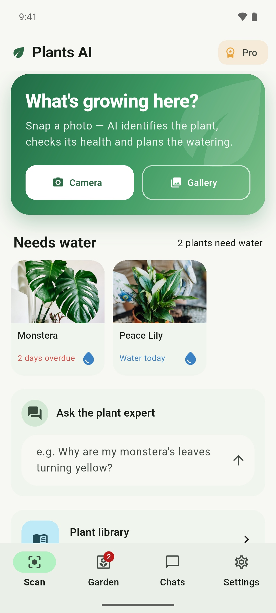
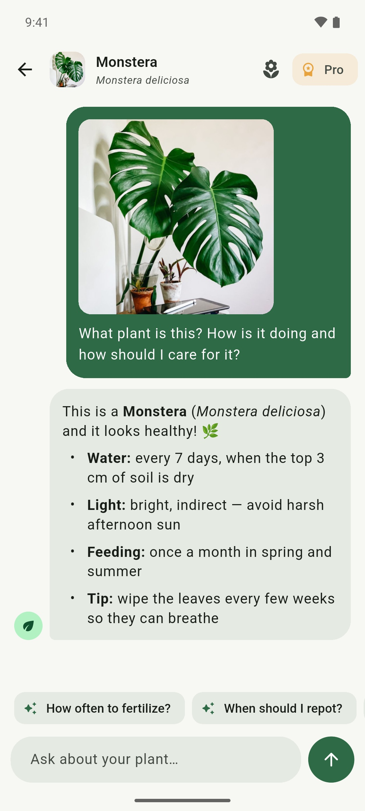
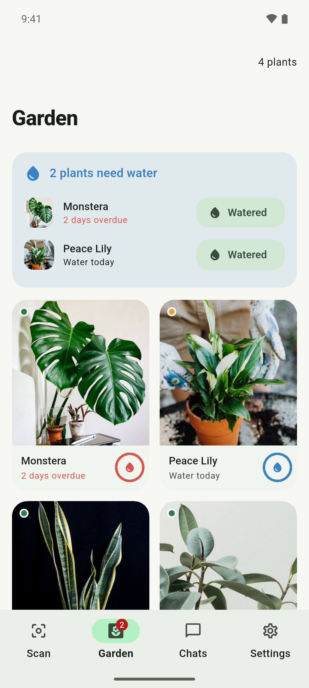
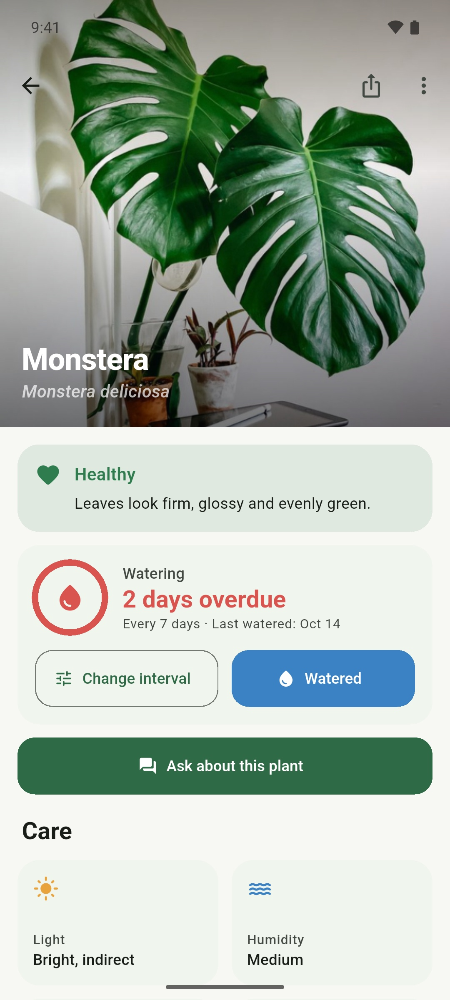
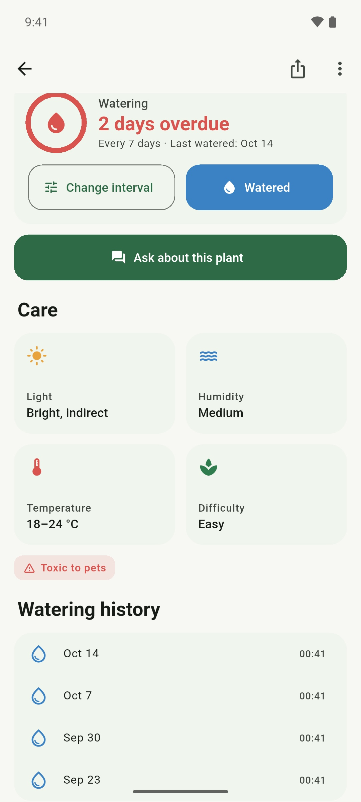
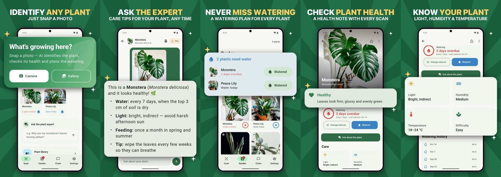

# Plant care: Identifier AI (Plants AI)

Flutter: rozpoznawanie roślin ze zdjęcia, porady AI i plan podlewania. [Google Play](https://play.google.com/store/apps/details?id=com.inu.plantsai): `com.inu.plantsai`.



## Zrzuty ekranu

| Skanowanie | Odpowiedź AI | Mój ogród |
|---|---|---|
|  |  |  |

| Karta rośliny | Pielęgnacja i historia | |
|---|---|---|
|  |  | |

Grafiki w Google Play (`store/google-play/phone/`):



## Funkcje

- **Skanowanie:** zdjęcie z aparatu albo galerii, przycięcie, a potem AI rozpoznaje roślinę, ocenia jej kondycję i doradza.
- **Czat z ekspertem:** pytania uzupełniające (zdjęcie idzie z każdym pytaniem), szybkie pytania podpowiadane przez AI, pytania bez zdjęcia.
- **Mój ogród:** każda rozpoznana roślina dostaje profil opieki i harmonogram podlewania. Jest przycisk „Podlane”, historia podlewania, zmiana częstotliwości i licznik roślin do podlania na pasku nawigacji.
- **Encyklopedia:** 417 gatunków z wyszukiwarką (`assets/data/plants_library.json`).
- **Konto:** darmowe kredyty odnawiane codziennie, kredyty za reklamę z nagrodą, Pro przez RevenueCat.
- **Ustawienia:** 11 języków interfejsu i odpowiedzi AI (pełne tłumaczenia: en, pl), motyw jasny/ciemny/systemowy.

## Architektura

- **Backend:** wspólny projekt Convex [JakubJakubiak/ai-hub](https://github.com/JakubJakubiak/ai-hub) (prywatne repo; OpenAI, kredyty, Pro przez RevenueCat). Aplikacja łączy się przez pakiet `ai_hub_client` pobierany z gita (`clients/dart`, gałąź `main`), więc `flutter pub get` potrzebuje dostępu do tego repo (zalogowany `gh` / token HTTPS). Po zmianach w kliencie: `flutter pub upgrade ai_hub_client`.
  Żeby pracować na lokalnej kopii klienta, utwórz `pubspec_overrides.yaml` (jest w `.gitignore`):
  ```yaml
  dependency_overrides:
    ai_hub_client:
      path: ../ai-hub/clients/dart
  ```
- **Firebase:** tylko Analytics (`lib/core/analytics.dart`). Bez `google-services.json` / `GoogleService-Info.plist` aplikacja działa dalej, tylko bez statystyk.
- **Dane lokalne:** drift (`lib/database`): rozmowy, wiadomości, ogród (profil opieki, harmonogram podlewania) i historia podlewania.
- **UI:** Material 3, `lib/features/*` (scan, garden, chat, history, library, settings, paywall, onboarding).

```
lib/
  core/       konfiguracja, motyw, konto (ai-hub + RevenueCat), reklamy, analityka
  data/       ChatRepository, PlantCare/PlantReply
  database/   drift (schemat v4)
  features/   ekrany
  widgets/    wspólne komponenty
```

## Uruchomienie

```bash
flutter pub get
dart run build_runner build --delete-conflicting-outputs   # po zmianach w lib/models
flutter run
```

Adres backendu i klucz klienta są w `lib/core/config.dart`. Można je nadpisać przy buildzie:

```bash
flutter run --dart-define=AI_HUB_URL=https://<deployment>.convex.site --dart-define=AI_HUB_CLIENT_KEY=pk_plantsai_...
```

Testy: `flutter test`.

## Sklep

`store/make_store_graphics.py` buduje zrzuty i grafikę promocyjną do Google Play ze zrzutów emulatora (1080 × 2400) w `store/source/`:

```bash
python3 store/make_store_graphics.py
```

| Wynik | Rozmiar | Do czego |
|---|---|---|
| `store/google-play/phone/*.png` | 1080 × 1920 | zrzuty telefonu w Google Play (karta en-US, tłumaczenia je dziedziczą) |
| `store/google-play/feature-graphic.png` | 1024 × 500 | grafika promocyjna |

Nagłówki i powiększany fragment interfejsu ustawia się w `SHOTS` i `COPY` na górze skryptu.

### Nowe zrzuty źródłowe

AI nie jest potrzebne, bo dane pochodzą z gotowej bazy z przykładowymi roślinami:

1. Zbuduj bazę: `OUT=build/demo_chat.db flutter test store/demo/seed_demo_db_test.dart`.
2. Zainstaluj build debug na emulatorze, przejdź onboarding i zamknij aplikację (`adb shell am force-stop com.inu.plantsai`).
3. Wgraj bazę i zdjęcia (drift zapisuje plik jako `chat.db.sqlite`):
   ```bash
   adb push build/demo_chat.db /data/local/tmp/chat.db
   adb shell run-as com.inu.plantsai cp /data/local/tmp/chat.db app_flutter/chat.db.sqlite
   adb shell run-as com.inu.plantsai mkdir -p app_flutter/plants
   for f in store/demo/plants/*.jpg; do adb push "$f" /data/local/tmp/; adb shell run-as com.inu.plantsai cp /data/local/tmp/$(basename "$f") app_flutter/plants/; done
   ```
4. Schowaj baner reklamy: nadaj urządzeniu Pro w ai-hub (`npx convex run users:grant '{"slug":"plantsai","deviceId":"…","proDays":1}'`, `deviceId` jest w `shared_prefs/FlutterSharedPreferences.xml` pod `flutter.deviceId`).
5. Włącz czysty pasek statusu (`adb shell settings put global sysui_demo_allowed 1`, potem `adb shell am broadcast -a com.android.systemui.demo -e command clock -e hhmm 0941` itd.) i zrób zrzuty: `adb exec-out screencap -p > store/source/home.png`. Zapisz je jako JPEG pod nazwami używanymi w `SHOTS`.

Zdjęcia roślin w `store/demo/plants/` pochodzą z Pexels (licencja pozwala na użycie komercyjne). Zdjęć z encyklopedii (whatflower.net) nie używamy w materiałach sklepowych, bo prawa do nich są niejasne.

## Uwagi

- Stary kod (przed wersją 2.0) leży w `_legacy/` tylko do wglądu; analizator go pomija.
- iOS nie jest skonfigurowany (brak klucza RevenueCat, ID AdMob i pliku Firebase); aplikacja się uruchomi, ale bez zakupów i analityki.
